# Hermes Bots Desktop

A native Linux desktop client for [Hermes Agent](https://github.com/NousResearch/hermes-agent) **Bot Mode**, written in Rust with [iced](https://iced.rs).

- **Roster** of your always-on Bots, with live status and a "Needs you" section.
- **Bot chat** with streamed replies, tool activity and approval requests.
- **Bot Screen**: watch the Bot's computer live, take control (for example to sign in to a website), then hand it back.
- **Sign-in** through your system browser (OAuth PKCE). Tokens go to the OS keyring (Secret Service), never to a file.
- Reconnects with backoff, and shows clear offline and error states.

The app talks only to the gateway API (REST, WebSocket and RFB). It does not embed or scrape the Webapp.
It is one native binary: no webview, Electron, Tauri or Node.

## Screenshots

All screenshots use the mock gateway in this repo and mock Bots.

| | |
|---|---|
| 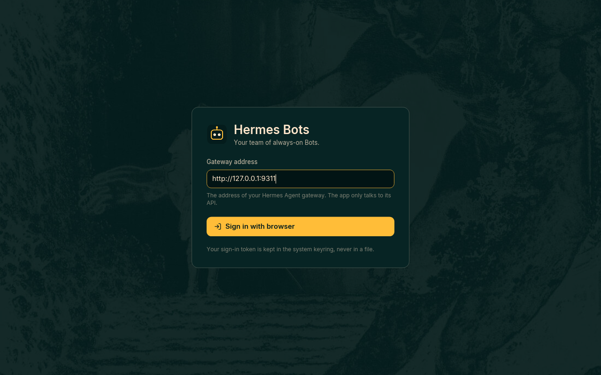 Sign-in | 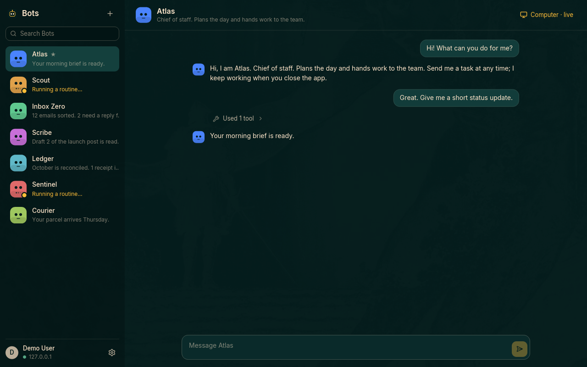 Roster |
| 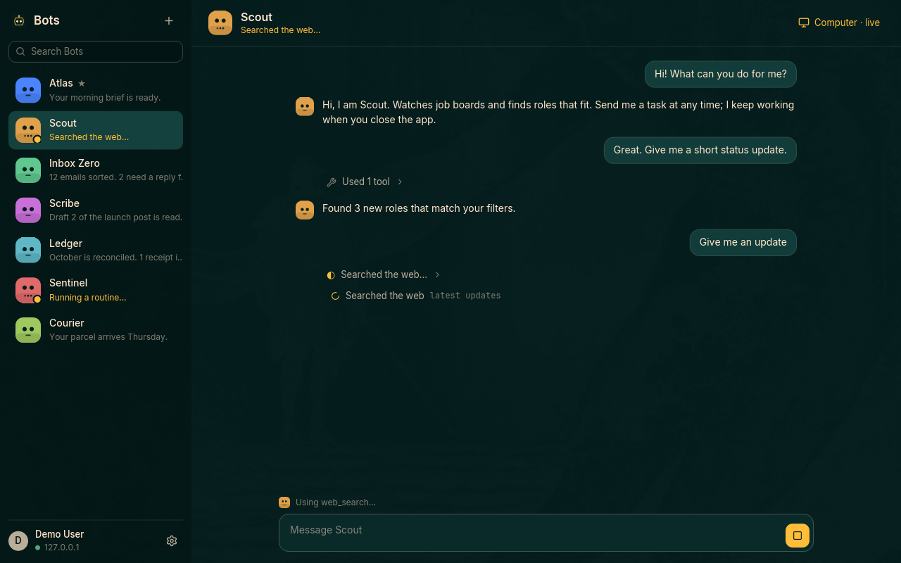 Chat, streaming with tools | 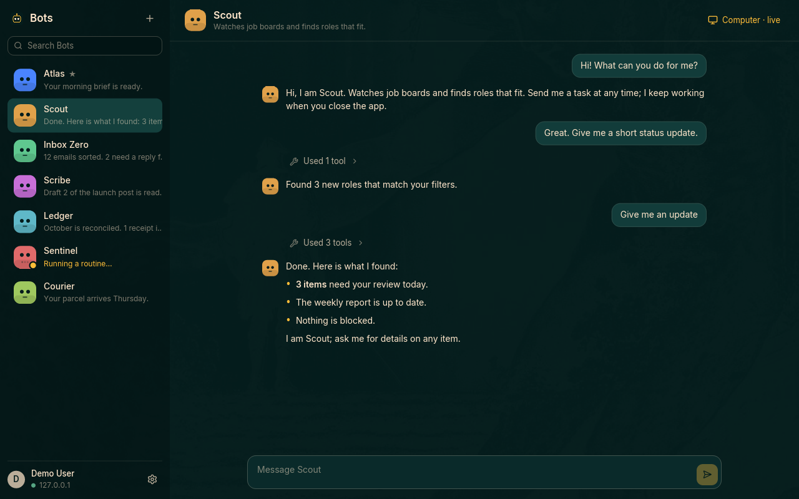 Chat, finished reply |
| 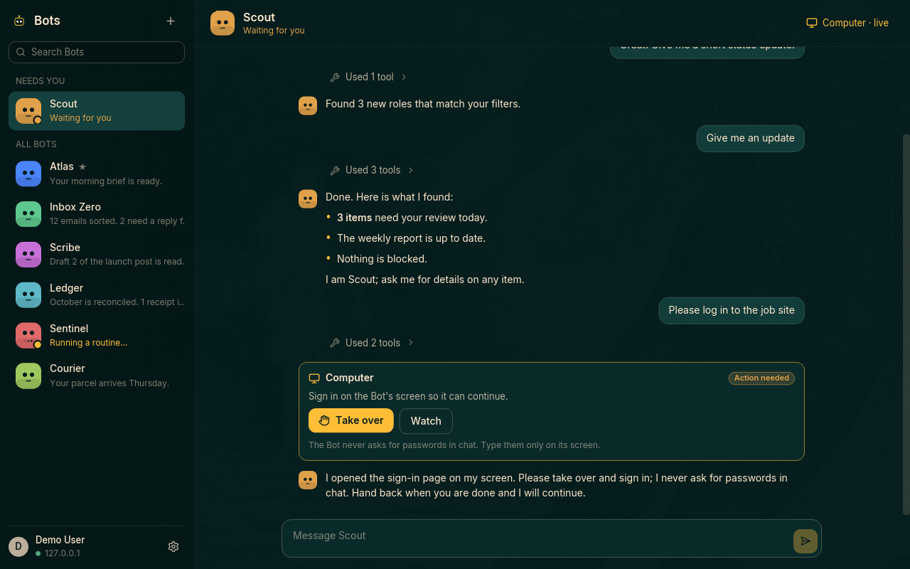 The Bot asks you to sign in | 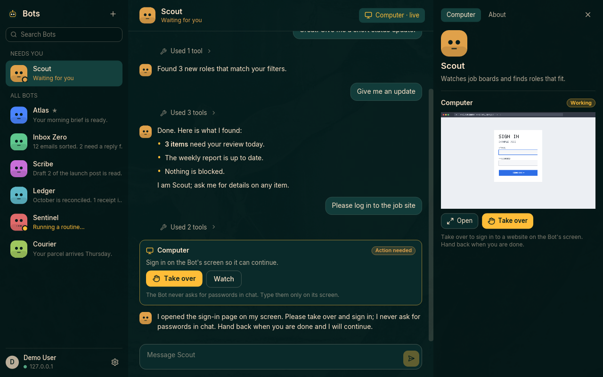 Live computer preview |
| 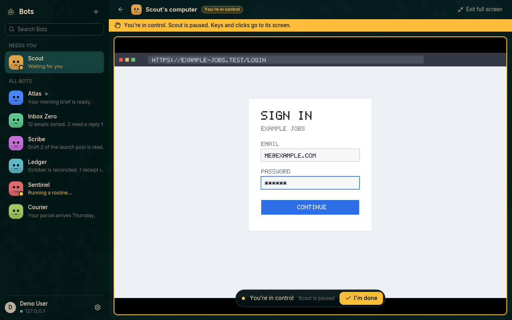 Bot Screen, you are in control | 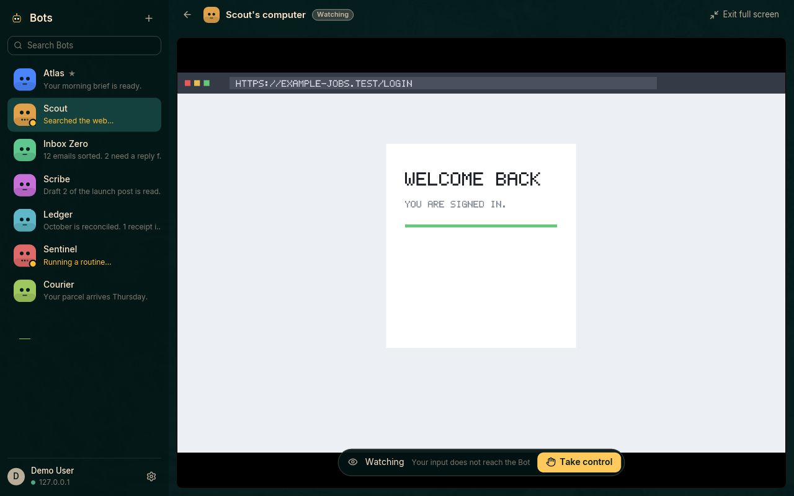 Bot Screen, watching |
| 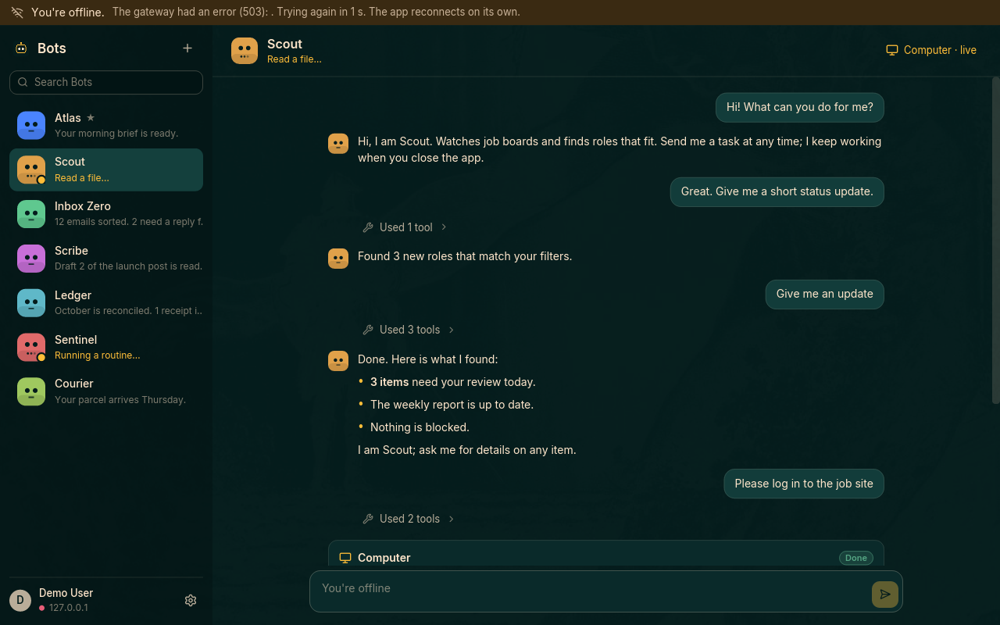 Offline | 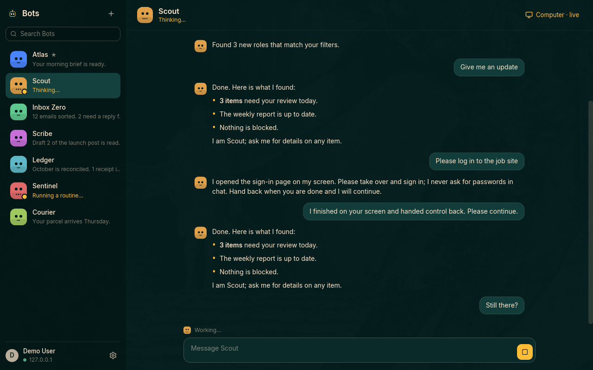 Settings |
| 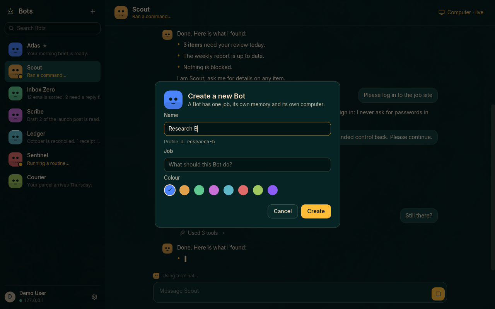 New Bot | 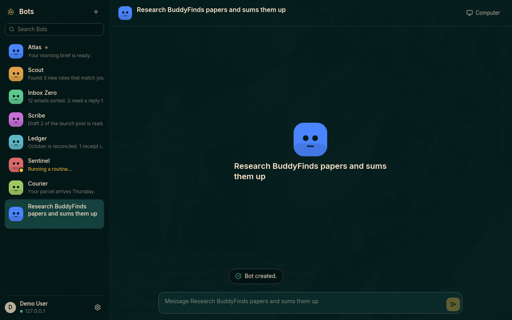 New Bot in the roster |

## Install on Arch Linux / Omarchy

### 1. Dependencies

```sh
sudo pacman -S --needed git base-devel rustup pkgconf \
  libxkbcommon libxkbcommon-x11 libxcb wayland vulkan-icd-loader mesa fontconfig dbus libsecret \
  gnome-keyring
rustup default stable
```

- The minimum Rust version is **1.88** (edition 2024).
- You need a Secret Service provider to keep the sign-in tokens, for example `gnome-keyring` or KWallet.
  To check: `busctl --user list | grep -i secrets`. If there is no provider, the app keeps the tokens in memory only, and you must sign in again at each start.

### 2. Build and install (user only, no root)

```sh
git clone https://github.com/Drastixs/hermes-bots-desktop
cd hermes-bots-desktop
scripts/install-user.sh
```

The script builds the release binary and installs these files:

- `~/.local/bin/hermes-bots`
- `~/.local/share/applications/io.github.drastixs.HermesBots.desktop`
- `~/.local/share/icons/hicolor/<N>x<N>/apps/io.github.drastixs.HermesBots.png`

Then start **Hermes Bots** from your app launcher, or run `hermes-bots`.

To remove the app: `scripts/install-user.sh --uninstall`. This does not remove your settings or keyring entries.

### Other ways

- **Release binary:** download `hermes-bots` from the [Releases](https://github.com/Drastixs/hermes-bots-desktop/releases) page into `target/release/` of a clone, then run `scripts/install-user.sh --no-build`.
- **PKGBUILD:** `cd packaging/arch && makepkg -si`. This builds the `v0.1.0` tag and installs to `/usr`. To build `main`: `_ref=branch=main makepkg -si`.

## Connect to your gateway

1. Start the app and type your gateway address (for example `https://hermes.example.com`) on the sign-in screen.
2. Click **Sign in with browser** and finish the sign-in in your browser.

The app saves the address in `~/.config/hermes-bots-desktop/settings.json`. This file holds no secrets.
To see the connection, open Settings (**Ctrl+,**). To use another gateway, sign out and type the new address.

Keyboard: **Ctrl+N** new Bot, **Ctrl+,** settings, **Ctrl+1…9** select a Bot, **Esc** close.

### Environment variables

| Variable | Effect |
|---|---|
| `HERMES_GATEWAY_URL` | Use this gateway for this run. It is not saved and does not replace the saved address. |
| `HERMES_BOTS_CONFIG_DIR` | Use this folder for `settings.json` instead of `~/.config/hermes-bots-desktop`. |
| `HERMES_BOTS_NO_KEYRING=1` | Do not use the keyring. Tokens stay in memory for this run. |
| `HERMES_BOTS_NO_BROWSER=1` | Do not open a browser (tests). |
| `HERMES_BOTS_AUTO_SIGNIN=1` | Start the sign-in at launch (tests). |

## Development

```sh
cargo build --workspace
cargo test --workspace                          # unit, contract and integration tests
cargo clippy --workspace --all-targets -- -D warnings
cargo fmt --all --check
```

If the build runs out of memory, set `CARGO_BUILD_JOBS=2`.

The workspace has three crates:

- `crates/hermes-api`: the client library. It has REST, the PKCE sign-in, the gateway WebSocket (JSON-RPC) and an RFB decoder.
- `crates/mock-hermes`: a mock gateway with 7 Bots, streaming, tools, a fake Bot Screen, PKCE, token expiry, socket drops and errors.
- `crates/app`: the desktop app (binary `hermes-bots`).

### Try it with the mock gateway

Use a separate config folder and no keyring, so the test cannot touch your real settings or tokens:

```sh
cargo run --release -p mock-hermes -- --addr 127.0.0.1:8787 &
HERMES_GATEWAY_URL=http://127.0.0.1:8787 \
HERMES_BOTS_CONFIG_DIR="$(mktemp -d)" \
HERMES_BOTS_NO_KEYRING=1 \
  cargo run --release -p hermes-bots
kill %1
```

Click **Sign in with browser**, then approve on the mock page in the browser. No real account is used.
Type "please log in" in a chat to see the Bot Screen take-over, or "clean up" to see an approval request.

### End-to-end test and screenshots

`scripts/e2e.sh` starts the real binary on a virtual X display against the mock, drives it, checks
the mock state after each step and saves screenshots (default `docs/screenshots/`).
It needs `Xvfb`, `xdpyinfo`, `xdotool`, ImageMagick (`import`), `curl` and `python3`.
On Arch: `sudo pacman -S xorg-server-xvfb xorg-xdpyinfo xdotool imagemagick`.

```sh
cargo build --workspace
scripts/e2e.sh
```

## Licence

MIT. See `LICENSE`. For fonts, icons and the wallpaper, see [THIRD_PARTY.md](THIRD_PARTY.md).
This project has no relation to xAI.
